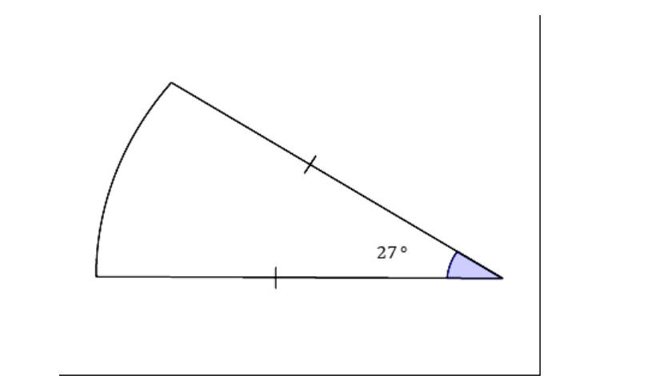
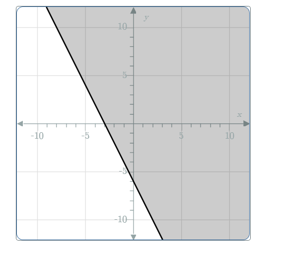

# AVP0099 — Single visual target

MathVerse:413 / MathVerse:510 · different type · Mathematical roles of graphical elements

## Shared or similar visual information

Shaded region

## Evidence locations

- Left image: The small purple angle region labeled 27 degrees at the lower-right corner of the diagram.
- Right image: The gray region covering the coordinate grid to the right of the sloping straight line.

## Mathematical meanings

Left image: Highlights the angle between two sides, annotated with its measure in degrees. Right image: Represents the half-plane solution set of an inequality delimited by a straight-line boundary.

## Same mathematical meanings

no

## Rationales

An angle highlight and a solution-set region have different mathematical roles, although both use color to fill a two-dimensional region.

Only the selected target is annotated. AI visual-review draft; not independently double-annotated by humans.
