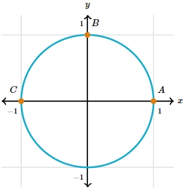
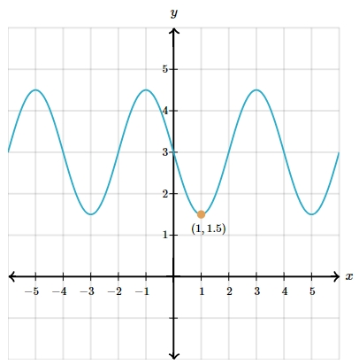

# AVP0100 — Single visual target

MathVerse:528 / MathVerse:541 · different type · Mathematical roles of graphical elements

## Shared or similar visual information

Filled circular marker on a curve

## Evidence locations

- Left image: The orange filled circular marker beside B at the top of the circle.
- Right image: The orange filled circular marker beside (1,1.5) at a trough of the waveform.

## Mathematical meanings

Left image: Highlights and locates a designated position on a geometric curve. Right image: Highlights and locates a designated position on a function curve.

## Same mathematical meanings

yes

## Rationales

Only the general position-marking role is compared; the left point is not interpreted as a domain endpoint, and although the right point is at a trough, the filled marker itself still serves to locate it.

Only the selected target is annotated. AI visual-review draft; not independently double-annotated by humans.
