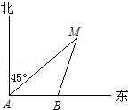
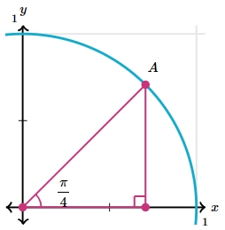

# AVP0101 — Single visual target

MathVista:587 / MathVerse:439 · same type · Numeric representation and conversion

## Shared or similar visual information

The numerical notations 45° (left) and π/4 (right).

## Evidence locations

- Left image: The notation 45° appears between the north direction and the line from A to M.
- Right image: The notation π/4 appears beside the arc at the origin.

## Mathematical meanings

Left image: 45° measures the indicated angle at A. Right image: π/4 radians measures the angle at the origin between the positive horizontal ray and OA.

## Same mathematical meanings

yes

## Rationales

π/4 radians equals 45°, and both notations measure the marked angle in their respective diagrams.

Only the selected target is annotated. AI visual-review draft; not independently double-annotated by humans.
