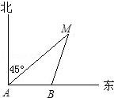

# AVP0101 — Single visual target

MathVista:587 / MathVerse:439 · same type · Numeric representation and conversion

## Shared or similar visual information

Numerical notations 45° and π/4.

## Evidence locations

- Left image: The 45° between the north-pointing ray and ray AM, at A.
- Right image: The π/4 beside the angle at the coordinate origin.

## Mathematical meanings

Left image: The marked angle at A measures 45 degrees. Right image: The marked angle at the origin measures π/4 radians.

## Same mathematical meanings

yes

## Rationales

45 degrees equals π/4 radians. The selected labels both quantify the size of a marked angle.

Only the selected target is annotated. AI visual-review draft; not independently double-annotated by humans.
