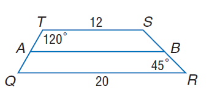
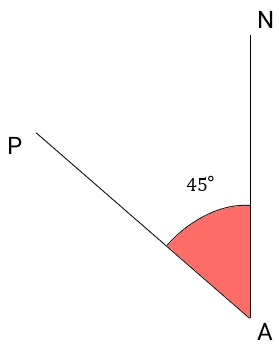

# AVP0102 — Single visual target

MathVista:866 / MathVerse:331 · same type · Numeric representation and conversion

## Shared or similar visual information

The numerical notation 45° in both images.

## Evidence locations

- Left image: The 45° beside vertex R at the lower right of the trapezoid.
- Right image: The 45° in the red angle region at A.

## Mathematical meanings

Left image: The marked interior angle at R measures 45 degrees. Right image: The marked angle at A measures 45 degrees.

## Same mathematical meanings

yes

## Rationales

Both degree labels assign the value 45 to a marked angle; their different vertices do not change the selected angle-measure role.

Only the selected target is annotated. AI visual-review draft; not independently double-annotated by humans.
