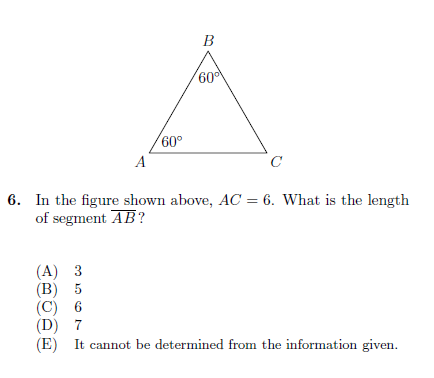
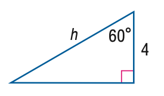

# AVP0103 — Single visual target

MathVista:234 / MathVista:665 · same type · Numeric representation and conversion

## Shared or similar visual information

The numerical notation 60° in both images.

## Evidence locations

- Left image: The 60° at vertex A of the triangle, above the printed question.
- Right image: The 60° beside the top-right vertex of the right triangle.

## Mathematical meanings

Left image: The triangle angle at A measures 60 degrees. Right image: The upper-right interior angle measures 60 degrees.

## Same mathematical meanings

yes

## Rationales

Both selected labels state an interior angle measure of 60 degrees.

Only the selected target is annotated. AI visual-review draft; not independently double-annotated by humans.
