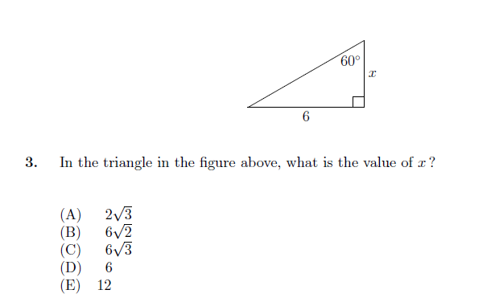
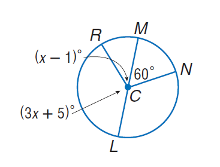

# AVP0104 — Single visual target

MathVista:698 / MathVista:815 · same type · Numeric representation and conversion

## Shared or similar visual information

The numerical notation 60° in both images.

## Evidence locations

- Left image: The 60° at the upper-right vertex of the small triangle above the question.
- Right image: The 60° inside the circle, between radii CM and CN.

## Mathematical meanings

Left image: The marked triangle angle measures 60 degrees. Right image: The central angle MCN measures 60 degrees.

## Same mathematical meanings

yes

## Rationales

Both labels quantify an angle as 60 degrees. One angle is at a triangle vertex and the other at a circle center; the numerical angle measure is the selected target.

Only the selected target is annotated. AI visual-review draft; not independently double-annotated by humans.
