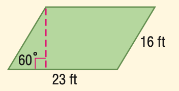
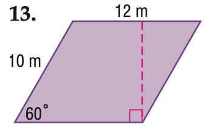

# AVP0105 — Single visual target

MathVista:737 / MathVista:822 · same type · Numeric representation and conversion

## Shared or similar visual information

The numerical notation 60° in both images.

## Evidence locations

- Left image: The 60° at the lower-left vertex of the green parallelogram.
- Right image: The 60° at the lower-left vertex of the purple parallelogram.

## Mathematical meanings

Left image: The lower-left interior angle measures 60 degrees. Right image: The lower-left interior angle measures 60 degrees.

## Same mathematical meanings

yes

## Rationales

Both selected labels give a parallelogram interior angle of 60 degrees.

Only the selected target is annotated. AI visual-review draft; not independently double-annotated by humans.
