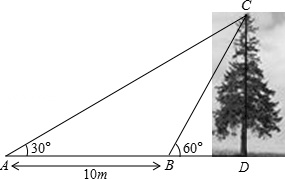
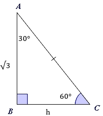

# AVP0106 — Single visual target

MathVista:523 / MathVerse:369 · same type · Numeric representation and conversion

## Shared or similar visual information

The numerical notation 30° in both images.

## Evidence locations

- Left image: The 30° beside A at the left end of the horizontal ground line.
- Right image: The 30° inside the triangle at A.

## Mathematical meanings

Left image: The marked angle between the ground and AC measures 30 degrees. Right image: The interior angle at A measures 30 degrees.

## Same mathematical meanings

yes

## Rationales

Both selected labels give an angle measure of 30 degrees.

Only the selected target is annotated. AI visual-review draft; not independently double-annotated by humans.
