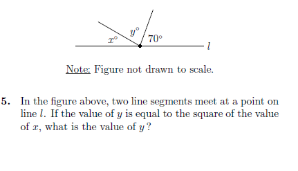
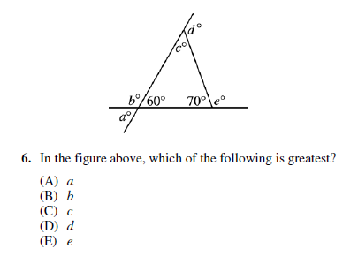

# AVP0107 — Single visual target

MathVista:304 / MathVista:342 · same type · Numeric representation and conversion

## Shared or similar visual information

The numerical notation 70° in both images.

## Evidence locations

- Left image: The 70° above the right side of line l, beside the right sloping ray.
- Right image: The 70° inside the triangle at its lower-right vertex.

## Mathematical meanings

Left image: The marked angle between that ray and the rightward horizontal ray measures 70 degrees. Right image: The lower-right interior angle measures 70 degrees.

## Same mathematical meanings

yes

## Rationales

Both selected labels specify 70 degrees for the indicated angle, despite the different surrounding constructions.

Only the selected target is annotated. AI visual-review draft; not independently double-annotated by humans.
