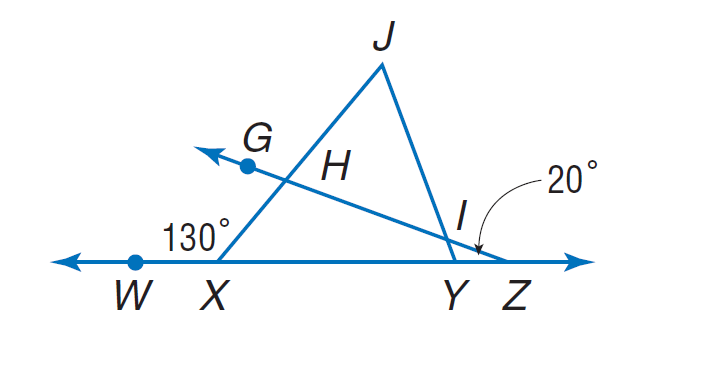
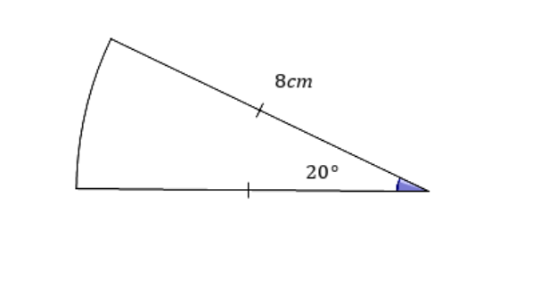

# AVP0108 — Single visual target

MathVista:360 / MathVerse:407 · same type · Numeric representation and conversion

## Shared or similar visual information

The numerical notation 20° in both images.

## Evidence locations

- Left image: The 20° with a leader pointing to the small angle at Y.
- Right image: The 20° in the small angle region at the sector's right-hand vertex.

## Mathematical meanings

Left image: The selected angle at Y measures 20 degrees. Right image: The marked central angle measures 20 degrees.

## Same mathematical meanings

yes

## Rationales

Both selected degree labels assign angle measure 20 degrees.

Only the selected target is annotated. AI visual-review draft; not independently double-annotated by humans.
