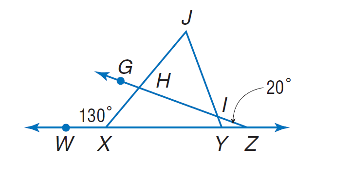
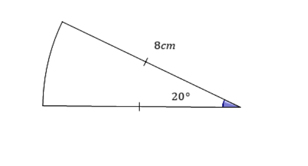

# AVP0108 — Single visual target

MathVista:360 / MathVerse:407 · same type · Numeric representation and conversion

## Shared or similar visual information

The numerical notation 20°.

## Evidence locations

- Left image: The notation 20° appears at the tip of the curved annotation near Z.
- Right image: The notation 20° appears next to the purple wedge at the sector vertex.

## Mathematical meanings

Left image: 20° measures the marked angle where the long oblique line meets the baseline. Right image: 20° measures the angle between the two radii.

## Same mathematical meanings

yes

## Rationales

Each notation is placed next to the marked angle and specifies the same angle measure of 20°.

Only the selected target is annotated. AI visual-review draft; not independently double-annotated by humans.
