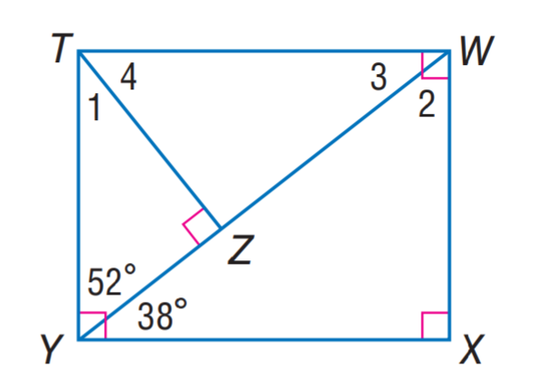
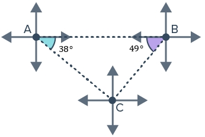

# AVP0109 — Single visual target

MathVista:48 / MathVerse:342 · same type · Numeric representation and conversion

## Shared or similar visual information

The numerical notation 38° in both images.

## Evidence locations

- Left image: The 38° at Y between diagonal YW and the bottom edge YX.
- Right image: The 38° in the small colored angle region at A.

## Mathematical meanings

Left image: The angle WYX measures 38 degrees. Right image: The selected angle at A measures 38 degrees.

## Same mathematical meanings

yes

## Rationales

Both selected labels specify an angle of 38 degrees; the distinct reference rays do not alter the selected numerical angle-measure role.

Only the selected target is annotated. AI visual-review draft; not independently double-annotated by humans.
