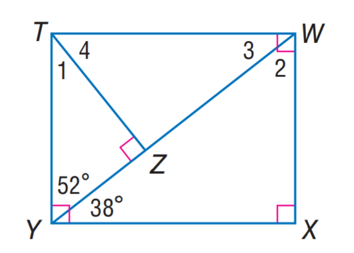
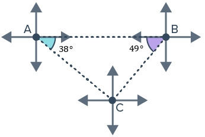

# AVP0109 — Single visual target

MathVista:48 / MathVerse:342 · same type · Numeric representation and conversion

## Shared or similar visual information

The numerical notation 38°.

## Evidence locations

- Left image: The notation 38° appears beside the diagonal near the bottom-left vertex.
- Right image: The notation 38° appears beside the cyan wedge at A.

## Mathematical meanings

Left image: 38° measures the angle at Y between YW and YX. Right image: 38° measures the angle between the eastward ray and AC.

## Same mathematical meanings

yes

## Rationales

Each notation is placed next to the marked angle and specifies the same angle measure of 38°.

Only the selected target is annotated. AI visual-review draft; not independently double-annotated by humans.
