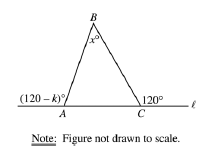
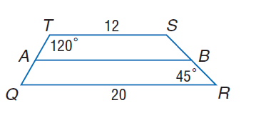

# AVP0110 — Single visual target

MathVista:434 / MathVista:866 · same type · Numeric representation and conversion

## Shared or similar visual information

The numerical notation 120° in both images.

## Evidence locations

- Left image: The 120° immediately to the right of C on the extended horizontal baseline.
- Right image: The 120° immediately below the top-left vertex T.

## Mathematical meanings

Left image: The exterior angle at C measures 120 degrees. Right image: The interior angle at T measures 120 degrees.

## Same mathematical meanings

yes

## Rationales

Both labels quantify an angle as 120 degrees. An exterior angle and an interior angle can have the same angle measure.

Only the selected target is annotated. AI visual-review draft; not independently double-annotated by humans.
