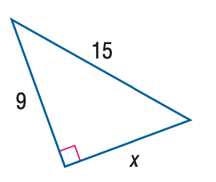
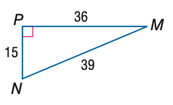

# AVP0111 — Single visual target

MathVista:160 / MathVista:388 · same type · Numeric representation and conversion

## Shared or similar visual information

The numerical notation 15 in both images.

## Evidence locations

- Left image: The 15 beside the upper sloping side of the blue right triangle.
- Right image: The 15 beside the left vertical side PN.

## Mathematical meanings

Left image: The upper sloping side has length value 15. Right image: Segment PN has length value 15.

## Same mathematical meanings

yes

## Rationales

The complete value 15 and the role of a segment-length value agree in both diagrams; no unprinted unit is assumed.

Only the selected target is annotated. AI visual-review draft; not independently double-annotated by humans.
