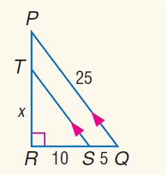

# AVP0113 — Single visual target

MathVista:238 / MathVista:386 · same type · Numeric representation and conversion

## Shared or similar visual information

The numerical notation 10 in both images.

## Evidence locations

- Left image: The 10 below the bottom segment RS.
- Right image: The 10 below the bottom side of the tall right triangle.

## Mathematical meanings

Left image: Segment RS has length value 10. Right image: The bottom side has length value 10.

## Same mathematical meanings

yes

## Rationales

Both occurrences of 10 specify the length value of a bottom segment.

Only the selected target is annotated. AI visual-review draft; not independently double-annotated by humans.
