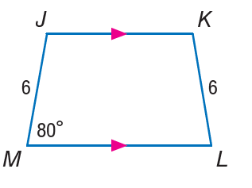

# AVP0114 — Single visual target

MathVista:310 / MathVista:786 · same type · Numeric representation and conversion

## Shared or similar visual information

The numerical notation 6 in both images.

## Evidence locations

- Left image: The 6 along the short upper-left portion of the hypotenuse.
- Right image: The 6 beside the left leg JM of the trapezoid.

## Mathematical meanings

Left image: The short hypotenuse portion between the upper-left vertex and the altitude foot has length value 6. Right image: Segment JM has length value 6.

## Same mathematical meanings

yes

## Rationales

Both occurrences of 6 are segment-length values. The target does not assert that the entire geometric objects are identical.

Only the selected target is annotated. AI visual-review draft; not independently double-annotated by humans.
