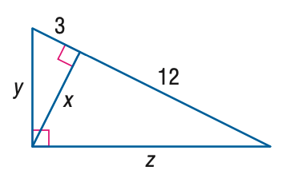
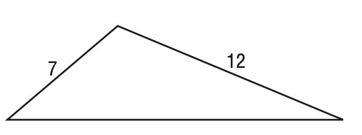

# AVP0115 — Single visual target

MathVista:408 / MathVista:615 · same type · Numeric representation and conversion

## Shared or similar visual information

The numerical notation 12 in both images.

## Evidence locations

- Left image: The 12 above the long upper-right portion of the hypotenuse.
- Right image: The 12 beside the right sloping side of the triangle.

## Mathematical meanings

Left image: The hypotenuse portion to the right of the altitude foot has length value 12. Right image: The right sloping side has length value 12.

## Same mathematical meanings

yes

## Rationales

Both occurrences of 12 give a geometric segment's length value.

Only the selected target is annotated. AI visual-review draft; not independently double-annotated by humans.
