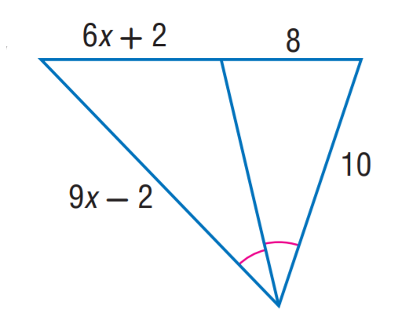
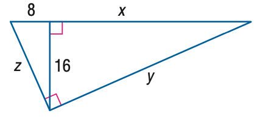

# AVP0116 — Single visual target

MathVista:713 / MathVista:716 · same type · Numeric representation and conversion

## Shared or similar visual information

The numerical notation 8 in both images.

## Evidence locations

- Left image: The 8 above the top-right section of the inverted triangle.
- Right image: The 8 above the short upper-left segment of the right triangle.

## Mathematical meanings

Left image: The top-right segment has length value 8. Right image: The short upper-left segment has length value 8.

## Same mathematical meanings

yes

## Rationales

Both occurrences of 8 specify the length value of a top segment.

Only the selected target is annotated. AI visual-review draft; not independently double-annotated by humans.
