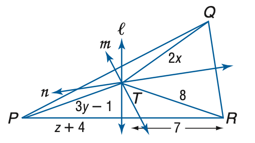
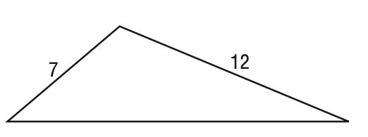

# AVP0117 — Single visual target

MathVista:575 / MathVista:615 · same type · Numeric representation and conversion

## Shared or similar visual information

The numerical notation 7 in both images.

## Evidence locations

- Left image: The 7 below the dimension arrow from T toward R.
- Right image: The 7 beside the left sloping side of the triangle.

## Mathematical meanings

Left image: Segment TR has length value 7. Right image: The left sloping side has length value 7.

## Same mathematical meanings

yes

## Rationales

The arrow-bracket label and the label next to a side both assign length value 7 to a selected segment.

Only the selected target is annotated. AI visual-review draft; not independently double-annotated by humans.
