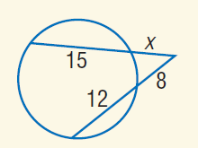
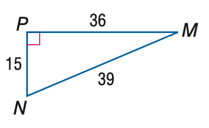

# AVP0119 — Single visual target

MathVista:757 / MathVista:388 · same type · Numeric representation and conversion

## Shared or similar visual information

The numerical notation 15 in both images.

## Evidence locations

- Left image: The 15 on the upper secant portion inside the circle.
- Right image: The 15 beside the left vertical side PN.

## Mathematical meanings

Left image: The internal portion of the upper secant has length value 15. Right image: Segment PN has length value 15.

## Same mathematical meanings

yes

## Rationales

An internal secant portion and a triangle leg are both segments whose displayed length value is 15.

Only the selected target is annotated. AI visual-review draft; not independently double-annotated by humans.
