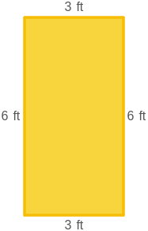

# AVP0120 — Single visual target

MathVista:56 / MathVista:71 · same type · Numeric representation and conversion

## Shared or similar visual information

Numerical notations 1 yd and 3 ft.

## Evidence locations

- Left image: The 1 yd above the top side of the orange rectangle.
- Right image: The 3 ft above the top side of the yellow rectangle.

## Mathematical meanings

Left image: The top side has length 1 yard. Right image: The top side has length 3 feet.

## Same mathematical meanings

yes

## Rationales

One yard equals three feet. Both labels give a side length and specify equal lengths after converting the displayed units.

Only the selected target is annotated. AI visual-review draft; not independently double-annotated by humans.
