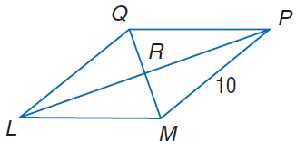
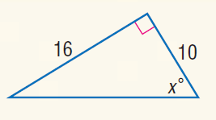

# AVP0121 — Single visual target

MathVista:777 / MathVista:678 · same type · Numeric representation and conversion

## Shared or similar visual information

The numerical notation 10 in both images.

## Evidence locations

- Left image: The 10 beside the lower-right side MP of the parallelogram.
- Right image: The 10 beside the right side of the inverted right triangle.

## Mathematical meanings

Left image: Segment MP has length value 10. Right image: The right side has length value 10.

## Same mathematical meanings

yes

## Rationales

Both selected side labels specify length value 10.

Only the selected target is annotated. AI visual-review draft; not independently double-annotated by humans.
