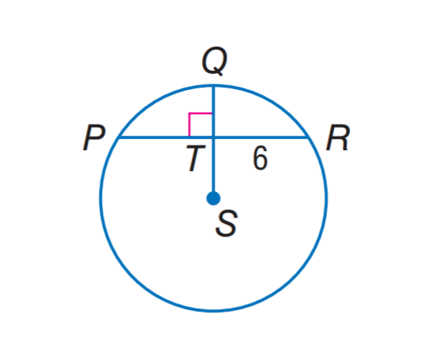

# AVP0122 — Single visual target

MathVista:990 / MathVista:310 · same type · Numeric representation and conversion

## Shared or similar visual information

The numerical notation 6 in both images.

## Evidence locations

- Left image: The 6 beside chord portion TR to the right of the vertical diameter.
- Right image: The 6 along the short upper-left portion of the hypotenuse.

## Mathematical meanings

Left image: Segment TR has length value 6. Right image: The short hypotenuse portion between the upper-left vertex and the altitude foot has length value 6.

## Same mathematical meanings

yes

## Rationales

Both occurrences of 6 specify a segment-length value; the chord portion and the hypotenuse portion need not be the same object.

Only the selected target is annotated. AI visual-review draft; not independently double-annotated by humans.
