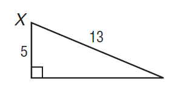
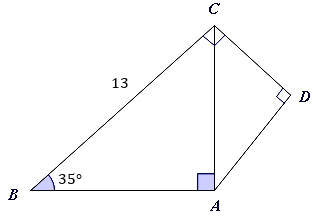

# AVP0123 — Single visual target

MathVista:333 / MathVerse:357 · same type · Numeric representation and conversion

## Shared or similar visual information

The numerical notation 13 in both images.

## Evidence locations

- Left image: The 13 above the hypotenuse of the right triangle.
- Right image: The 13 beside side BC on the left.

## Mathematical meanings

Left image: The hypotenuse has length value 13. Right image: Segment BC has length value 13.

## Same mathematical meanings

yes

## Rationales

The selected hypotenuse label and side label both give segment length value 13.

Only the selected target is annotated. AI visual-review draft; not independently double-annotated by humans.
