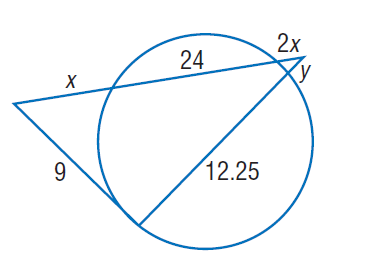
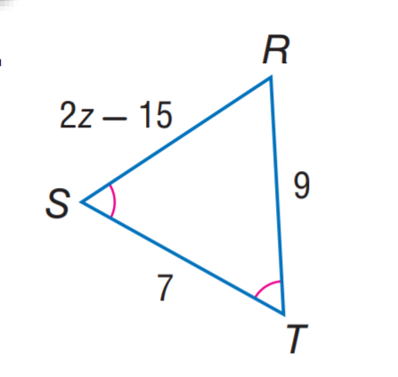

# AVP0124 — Single visual target

MathVista:816 / MathVista:236 · same type · Numeric representation and conversion

## Shared or similar visual information

The numerical notation 9 in both images.

## Evidence locations

- Left image: The 9 beside the tangent segment on the lower-left outside the circle.
- Right image: The 9 beside the right side RT.

## Mathematical meanings

Left image: The tangent segment from the external point has length value 9. Right image: Segment RT has length value 9.

## Same mathematical meanings

yes

## Rationales

Both occurrences of 9 give a segment-length value. Tangency versus triangle membership is outside this numeric target.

Only the selected target is annotated. AI visual-review draft; not independently double-annotated by humans.
