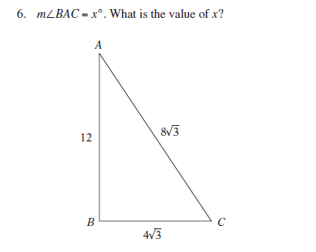
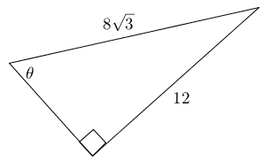

# AVP0125 — Single visual target

MathVista:920 / MathVerse:372 · same type · Numeric representation and conversion

## Shared or similar visual information

The numerical notation 8√3 in both images.

## Evidence locations

- Left image: The 8√3 beside sloping side AC.
- Right image: The 8√3 above the upper sloping side of the right triangle.

## Mathematical meanings

Left image: Segment AC has length 8√3. Right image: The upper sloping side has length 8√3.

## Same mathematical meanings

yes

## Rationales

The complete radical expression 8√3 agrees, and both occurrences give a geometric segment's length.

Only the selected target is annotated. AI visual-review draft; not independently double-annotated by humans.
