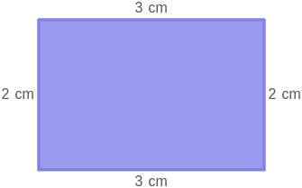

# AVP0126 — Single visual target

MathVista:441 / MathVista:606 · same type · Numeric representation and conversion

## Shared or similar visual information

The numerical notation 3 cm in both images.

## Evidence locations

- Left image: The 3 cm beside the left side of the cyan triangle.
- Right image: The 3 cm above the top horizontal side of the purple rectangle.

## Mathematical meanings

Left image: The left side has length 3 centimeters. Right image: The top side has length 3 centimeters.

## Same mathematical meanings

yes

## Rationales

Both complete quantity labels specify a side length of 3 centimeters. The numeral, unit, and quantity role all agree.

Only the selected target is annotated. AI visual-review draft; not independently double-annotated by humans.
