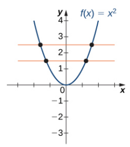

# AVP0127 — Single visual target

MathVista:137 / MathVista:156 · same type · Numeric representation and conversion

## Shared or similar visual information

The exponent 2 in the expressions x² and (x − 2)².

## Evidence locations

- Left image: The notation x² appears in the blue expression f(x) = x².
- Right image: The notation (x − 2)² appears next to the upper-right branch formula.

## Mathematical meanings

Left image: The variable x is squared in the displayed function rule. Right image: The expression x − 2 is squared for the right-hand branch.

## Same mathematical meanings

yes

## Rationales

The exponent 2 applies squaring to the base shown in each formula.

Only the selected target is annotated. AI visual-review draft; not independently double-annotated by humans.
