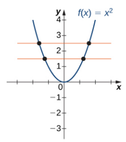

# AVP0127 — Single visual target

MathVista:137 / MathVista:156 · same type · Numeric representation and conversion

## Shared or similar visual information

The numerical notation 2 in both images.

## Evidence locations

- Left image: The superscript 2 in f(x)=x² at the upper right.
- Right image: The superscript 2 on (x−2) in the upper piecewise-function formula.

## Mathematical meanings

Left image: The variable x is squared; 2 is its exponent. Right image: The expression x−2 is squared; 2 is the exponent.

## Same mathematical meanings

yes

## Rationales

Both selected superscripts are exponent 2 and denote squaring of their respective bases. The bases x and x−2 need not be equal.

Only the selected target is annotated. AI visual-review draft; not independently double-annotated by humans.
