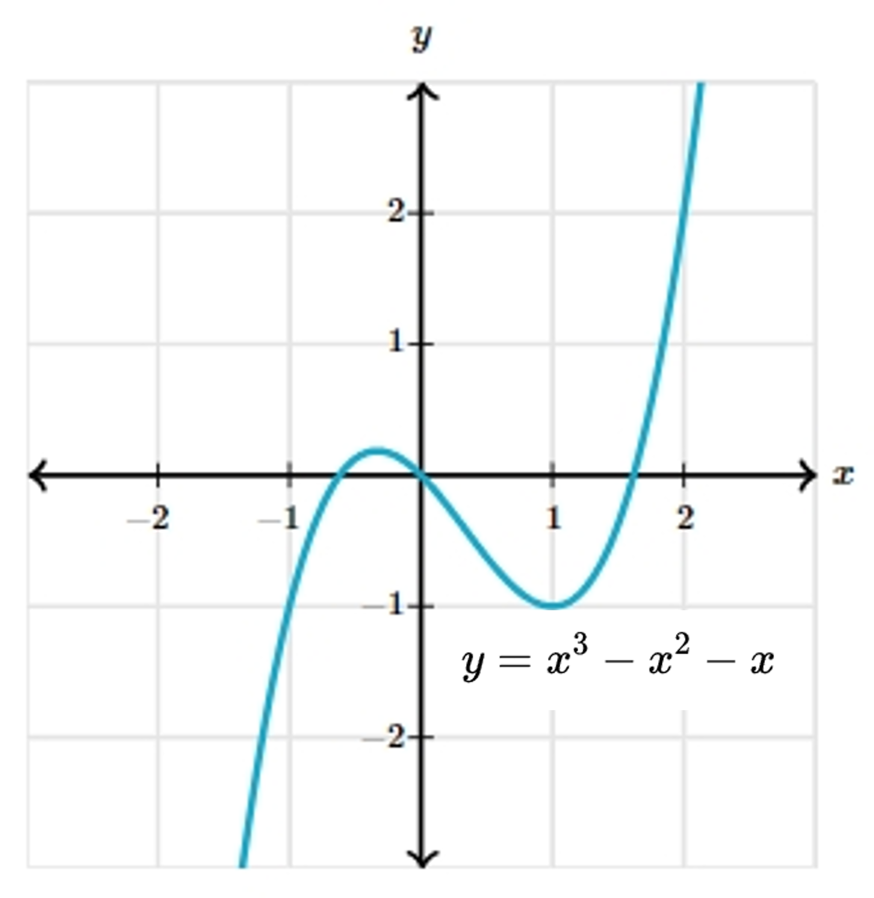

# AVP0128 — Single visual target

MathVista:767 / MathVerse:521 · different type · Numeric representation and conversion

## Shared or similar visual information

The numerical notation 2 in both images.

## Evidence locations

- Left image: The superscript 2 on x in x²+y²=25.
- Right image: The superscript 2 on x in y=x³−x²−x below the curve.

## Mathematical meanings

Left image: The x coordinate is squared; 2 is its exponent. Right image: The variable x in the selected term is squared; 2 is its exponent.

## Same mathematical meanings

yes

## Rationales

Both selected superscripts 2 denote squaring of x; no equivalence is claimed for the full equations.

Only the selected target is annotated. AI visual-review draft; not independently double-annotated by humans.
