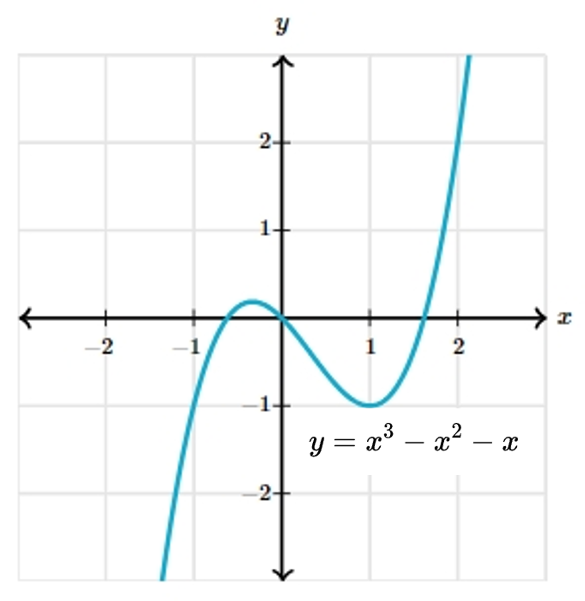

# AVP0128 — Single visual target

MathVista:767 / MathVerse:521 · different type · Numeric representation and conversion

## Shared or similar visual information

The exponent 2 in x².

## Evidence locations

- Left image: The notation x² appears in the first term of the circle equation.
- Right image: The notation x² appears in the middle term of y = x³ − x² − x.

## Mathematical meanings

Left image: The variable x is squared in the equation defining the circle. Right image: The variable x is squared in the quadratic term of the cubic expression.

## Same mathematical meanings

yes

## Rationales

The exponent 2 applies squaring to the base shown in each formula.

Only the selected target is annotated. AI visual-review draft; not independently double-annotated by humans.
