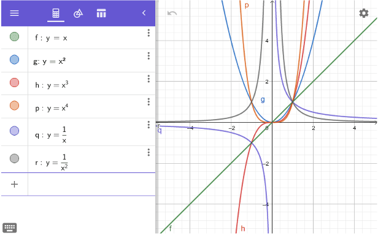
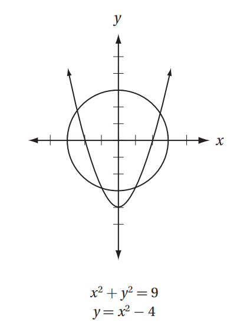

# AVP0129 — Single visual target

MathVista:991 / MathVerse:597 · same type · Numeric representation and conversion

## Shared or similar visual information

The numerical notation 2 in both images.

## Evidence locations

- Left image: The superscript 2 on x in the formula y=x² in the left formula list.
- Right image: The superscript 2 on x in the equation y=x²−4 below the plot.

## Mathematical meanings

Left image: The variable x is squared; 2 is its exponent. Right image: The variable x is squared; 2 is its exponent.

## Same mathematical meanings

yes

## Rationales

In each selected formula the superscript 2 is the exponent of x and denotes squaring.

Only the selected target is annotated. AI visual-review draft; not independently double-annotated by humans.
