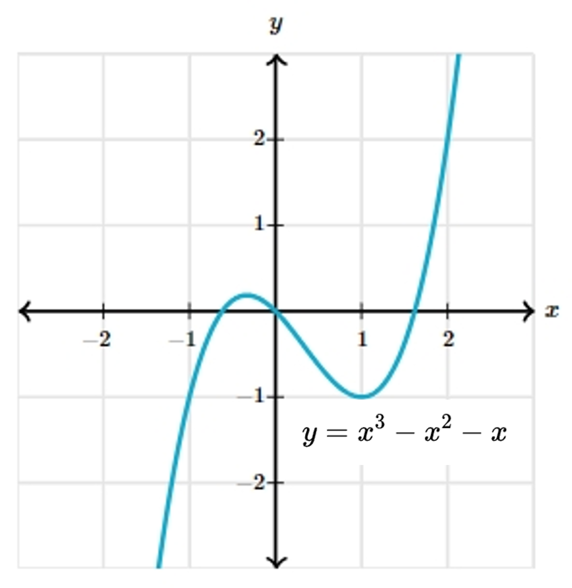

# AVP0130 — Single visual target

MathVista:369 / MathVerse:521 · same type · Numeric representation and conversion

## Shared or similar visual information

The numerical notation 3 in both images.

## Evidence locations

- Left image: The superscript 3 in f(x)=x³ at the upper right.
- Right image: The superscript 3 in y=x³−x²−x below the curve.

## Mathematical meanings

Left image: The variable x is cubed; 3 is its exponent. Right image: The variable x in the selected term is cubed; 3 is its exponent.

## Same mathematical meanings

yes

## Rationales

Both selected superscripts 3 denote cubing of x; the complete functions are not asserted to coincide.

Only the selected target is annotated. AI visual-review draft; not independently double-annotated by humans.
