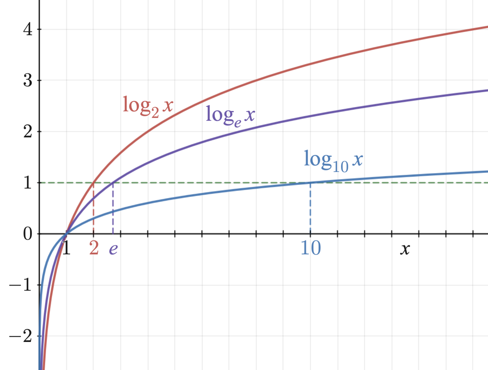

# AVP0131 — Single visual target

MathVista:329 / MathVista:847 · same type · Numeric representation and conversion

## Shared or similar visual information

The numerical notation 2 in both images.

## Evidence locations

- Left image: The subscript 2 in y=log₂(x), beside the curve.
- Right image: The subscript 2 in the red label log₂x.

## Mathematical meanings

Left image: The logarithm has base 2. Right image: The red logarithmic curve uses logarithm base 2.

## Same mathematical meanings

yes

## Rationales

Both selected subscripts give logarithm base 2, rather than a coordinate or a multiplier.

Only the selected target is annotated. AI visual-review draft; not independently double-annotated by humans.
