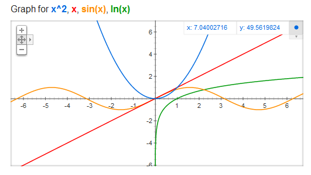

# AVP0132 — Single visual target

MathVista:302 / MathVista:671 · same type · Numeric representation and conversion

## Shared or similar visual information

The numerical notation 2 in both images.

## Evidence locations

- Left image: The superscript 2 in the blue x² item of the graph heading.
- Right image: The superscript 2 on (x−3) inside the square-root formula.

## Mathematical meanings

Left image: The variable x is squared; 2 is its exponent. Right image: The expression x−3 is squared; 2 is its exponent.

## Same mathematical meanings

yes

## Rationales

Both selected superscripts 2 denote squaring. The entire functions and bases are outside the selected exponent target.

Only the selected target is annotated. AI visual-review draft; not independently double-annotated by humans.
