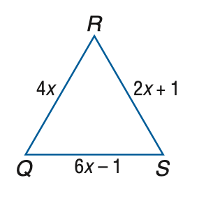
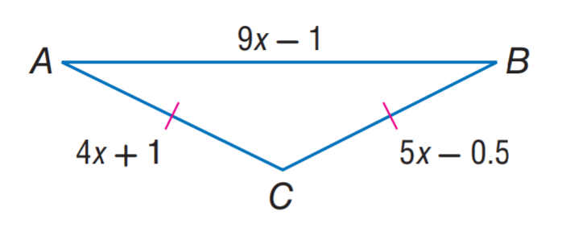

# AVP0133 — Single visual target

MathVista:176 / MathVista:375 · same type · Numeric representation and conversion

## Shared or similar visual information

The numerical notation 4 in both images.

## Evidence locations

- Left image: The coefficient 4 in the side-length expression 4x on RQ.
- Right image: The coefficient 4 in the left side-length expression 4x+1.

## Mathematical meanings

Left image: The unknown x is multiplied by coefficient 4 in the length expression. Right image: The unknown x is multiplied by coefficient 4 in the length expression.

## Same mathematical meanings

yes

## Rationales

Both selected 4s are coefficients multiplying x inside side-length expressions. The additional constant in one expression is not selected.

Only the selected target is annotated. AI visual-review draft; not independently double-annotated by humans.
