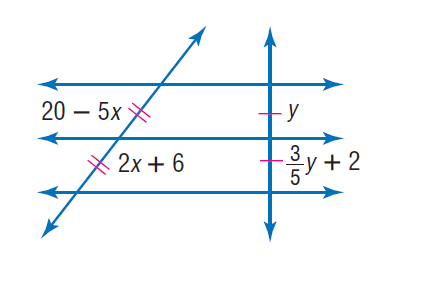
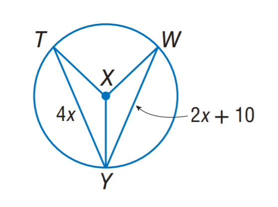

# AVP0134 — Single visual target

MathVista:271 / MathVista:283 · same type · Numeric representation and conversion

## Shared or similar visual information

The numerical notation 2 in both images.

## Evidence locations

- Left image: The coefficient 2 in 2x+6 below the lower marked slanted segment.
- Right image: The coefficient 2 in the right-hand chord label 2x+10.

## Mathematical meanings

Left image: The unknown x is multiplied by coefficient 2 in the length expression. Right image: The unknown x is multiplied by coefficient 2 in the length expression.

## Same mathematical meanings

yes

## Rationales

Both selected 2s multiply x inside a segment-length expression. Different additive constants are outside the selected coefficient target.

Only the selected target is annotated. AI visual-review draft; not independently double-annotated by humans.
