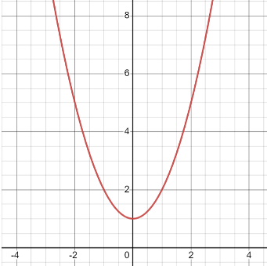

# AVP0136 — Single visual target

MathVista:409 / MathVista:346 · different type · Numeric representation and conversion

## Shared or similar visual information

The numerical notation 4 in both images.

## Evidence locations

- Left image: The tick label 4 on the positive vertical axis, left of the circle.
- Right image: The tick label 4 on the vertical axis above the parabola's vertex.

## Mathematical meanings

Left image: The selected tick denotes y-coordinate value 4. Right image: The selected tick denotes y-coordinate value 4.

## Same mathematical meanings

yes

## Rationales

Both selected vertical-axis ticks denote y-coordinate 4. A circle and a parabola supply different contexts for the same coordinate-scale value.

Only the selected target is annotated. AI visual-review draft; not independently double-annotated by humans.
