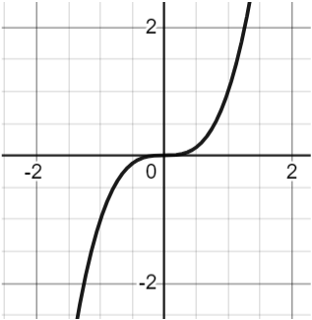

# AVP0137 — Single visual target

MathVista:120 / MathVista:329 · same type · Numeric representation and conversion

## Shared or similar visual information

The numerical notation 2 in both images.

## Evidence locations

- Left image: The tick label 2 at the positive right side of the horizontal axis.
- Right image: The tick label 2 below the first positive integer point of the logarithmic curve.

## Mathematical meanings

Left image: The selected tick denotes x-coordinate value 2. Right image: The selected tick denotes x-coordinate value 2.

## Same mathematical meanings

yes

## Rationales

Both selected horizontal-axis ticks denote x-coordinate 2.

Only the selected target is annotated. AI visual-review draft; not independently double-annotated by humans.
