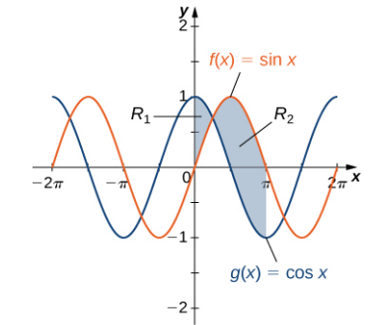

# AVP0138 — Single visual target

MathVista:308 / MathVista:287 · same type · Numeric representation and conversion

## Shared or similar visual information

Numerical notations 1.0 and 1.

## Evidence locations

- Left image: The tick label 1.0 at the top of the vertical scale.
- Right image: The tick label 1 above the origin on the vertical axis.

## Mathematical meanings

Left image: The selected tick denotes y-coordinate value 1.0. Right image: The selected tick denotes y-coordinate value 1.

## Same mathematical meanings

yes

## Rationales

1.0 equals 1, and both selected labels denote y-coordinate 1.

Only the selected target is annotated. AI visual-review draft; not independently double-annotated by humans.
