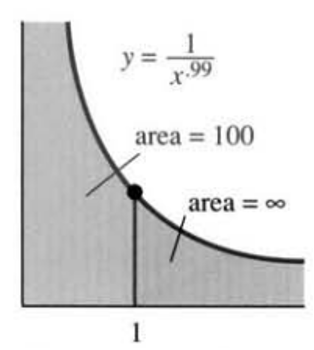
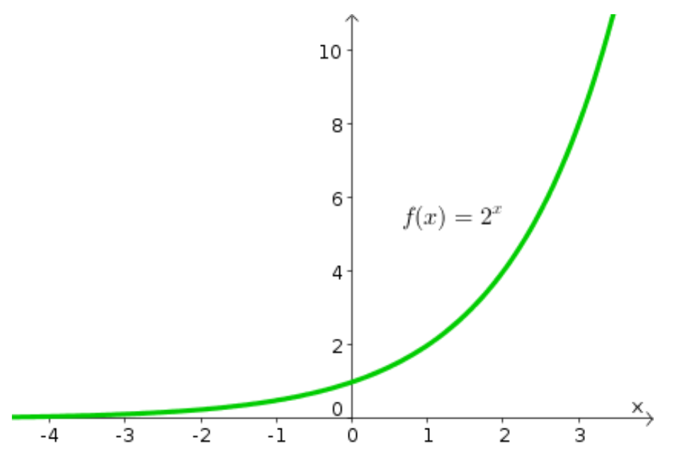

# AVP0140 — Single visual target

MathVista:717 / MathVista:619 · same type · Numeric representation and conversion

## Shared or similar visual information

The numerical notation 1 in both images.

## Evidence locations

- Left image: The tick label 1 below the marked point's vertical guide.
- Right image: The tick label 1 at the first positive integer on the horizontal axis.

## Mathematical meanings

Left image: The selected tick denotes x-coordinate value 1. Right image: The selected tick denotes x-coordinate value 1.

## Same mathematical meanings

yes

## Rationales

Both selected horizontal-axis ticks denote x-coordinate 1; the shaded area and the exponential base are outside this target.

Only the selected target is annotated. AI visual-review draft; not independently double-annotated by humans.
