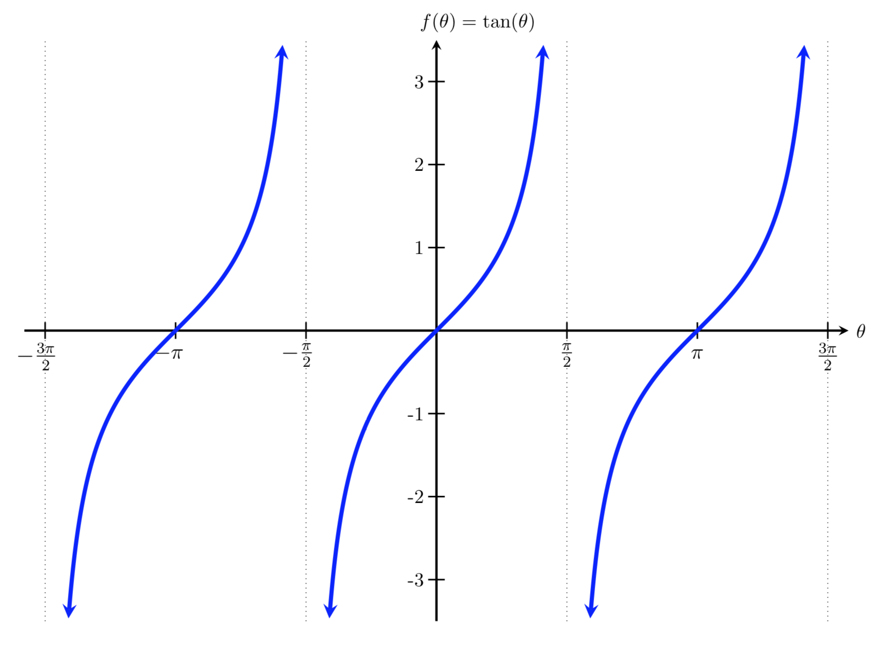

# AVP0141 — Single visual target

MathVista:592 / MathVista:661 · same type · Numeric representation and conversion

## Shared or similar visual information

The numerical notation π in both images.

## Evidence locations

- Left image: The tick label π on the positive horizontal axis, between π/2 and 3π/2.
- Right image: The tick label π at the positive zero of the right-hand tangent branch.

## Mathematical meanings

Left image: The selected tick denotes x-coordinate value π. Right image: The selected tick denotes x-coordinate value π.

## Same mathematical meanings

yes

## Rationales

Both selected horizontal-axis labels denote coordinate value π. This compares their coordinate role, not the different trigonometric functions.

Only the selected target is annotated. AI visual-review draft; not independently double-annotated by humans.
