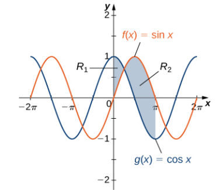

# AVP0142 — Single visual target

MathVista:287 / MathVista:592 · same type · Numeric representation and conversion

## Shared or similar visual information

The numerical notation −π in both images.

## Evidence locations

- Left image: The tick label −π on the negative horizontal axis, between −2π and the origin.
- Right image: The tick label −π on the negative horizontal axis, between −3π/2 and −π/2.

## Mathematical meanings

Left image: The selected tick denotes x-coordinate value −π. Right image: The selected tick denotes x-coordinate value −π.

## Same mathematical meanings

yes

## Rationales

Both complete signed expressions are −π and both denote horizontal coordinates.

Only the selected target is annotated. AI visual-review draft; not independently double-annotated by humans.
