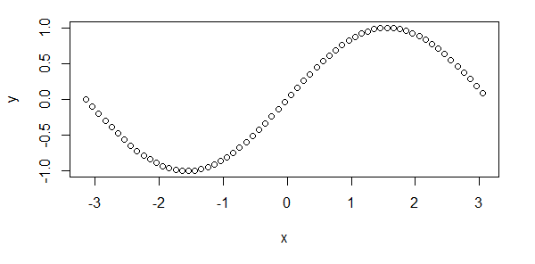

# AVP0143 — Single visual target

MathVista:118 / MathVista:770 · same type · Numeric representation and conversion

## Shared or similar visual information

The numerical notation −1.0 in both images.

## Evidence locations

- Left image: The tick label −1.0 at the bottom of the vertical axis.
- Right image: The tick label −1.0 at the bottom of the vertical axis.

## Mathematical meanings

Left image: The selected tick denotes y-coordinate value −1.0. Right image: The selected tick denotes y-coordinate value −1.0.

## Same mathematical meanings

yes

## Rationales

Both complete signed decimal labels denote y-coordinate −1.0.

Only the selected target is annotated. AI visual-review draft; not independently double-annotated by humans.
