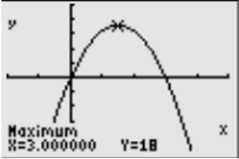

# AVP0144 — Single visual target

MathVista:217 / MathVista:671 · same type · Numeric representation and conversion

## Shared or similar visual information

Numerical notations 3.000000 and 3.

## Evidence locations

- Left image: The X=3.000000 readout below the graph, next to Maximum.
- Right image: The tick label 3 below the vertical radius at the top of the semicircle.

## Mathematical meanings

Left image: The marked maximum point has x-coordinate 3. Right image: The selected tick denotes x-coordinate value 3.

## Same mathematical meanings

yes

## Rationales

3.000000 equals 3. The calculator readout gives a point's x-coordinate and the axis tick denotes that same x-coordinate value.

Only the selected target is annotated. AI visual-review draft; not independently double-annotated by humans.
