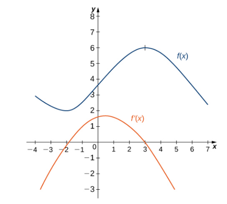

# AVP0145 — Single visual target

MathVista:34 / MathVista:963 · same type · Numeric representation and conversion

## Shared or similar visual information

The numerical notation 6 in both images.

## Evidence locations

- Left image: The tick label 6 at the top of the positive vertical scale.
- Right image: The tick label 6 above the origin on the vertical axis.

## Mathematical meanings

Left image: The selected tick denotes y-coordinate value 6. Right image: The selected tick denotes y-coordinate value 6.

## Same mathematical meanings

yes

## Rationales

Both selected vertical-axis labels denote y-coordinate 6.

Only the selected target is annotated. AI visual-review draft; not independently double-annotated by humans.
