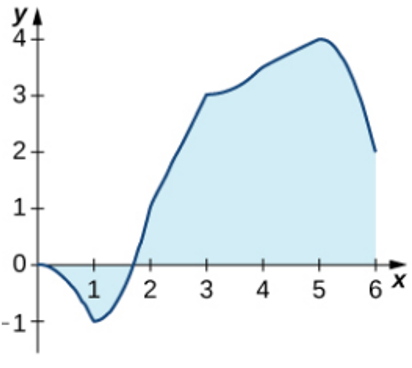
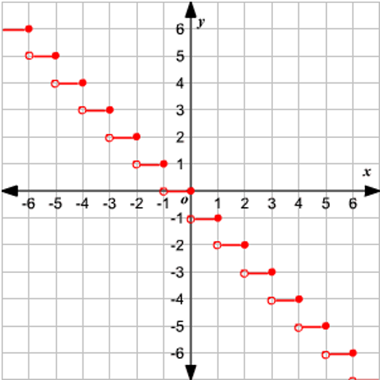

# AVP0146 — Single visual target

MathVista:260 / MathVista:34 · same type · Numeric representation and conversion

## Shared or similar visual information

The numerical notation 6 in both images.

## Evidence locations

- Left image: The tick label 6 at the right end of the horizontal scale.
- Right image: The tick label 6 at the rightmost labeled position on the horizontal axis.

## Mathematical meanings

Left image: The selected tick denotes x-coordinate value 6. Right image: The selected tick denotes x-coordinate value 6.

## Same mathematical meanings

yes

## Rationales

Both selected horizontal-axis ticks denote x-coordinate 6.

Only the selected target is annotated. AI visual-review draft; not independently double-annotated by humans.
