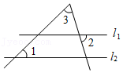
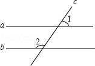

# AVP0147 — Single visual target

MathVista:149 / MathVista:355 · same type · Numeric representation and conversion

## Shared or similar visual information

The numerical notation 1 in both images.

## Evidence locations

- Left image: The standalone 1 beside the lower-left angle at the crossing on l2.
- Right image: The standalone 1 above the upper horizontal line, on the right of the transversal.

## Mathematical meanings

Left image: The numeral 1 identifies the adjacent angle region; it is an angle index, not a degree measure. Right image: The numeral 1 identifies the adjacent angle region; it is an angle index, not a degree measure.

## Same mathematical meanings

yes

## Rationales

Both standalone 1s serve as identifiers for angle regions. Neither is printed with a degree symbol or used as a measured angle value.

Only the selected target is annotated. AI visual-review draft; not independently double-annotated by humans.
